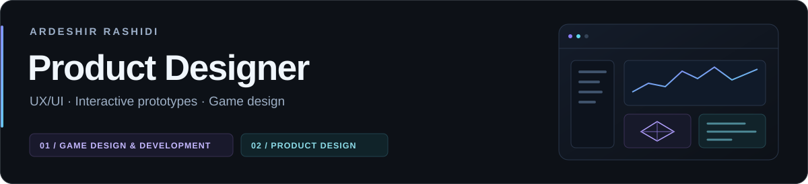

I am a **Product Designer** working across UX/UI, interactive product prototypes, and game design. I turn design ideas into experiences people can explore, from browser-based product flows to systems and playable experiments in Unreal Engine.

Based in **Stockholm, Sweden** · Studying **Game and Interactive Media Design at Uppsala University**

[LinkedIn](https://www.linkedin.com/in/ardeshir-rashidi/) · [All repositories](https://github.com/Ardeshir-Rashidi?tab=repositories)

**Design & Development Profile**

Self-assessed scores · [View the ratings](assets/skill-profile.json)

## Game Design & Development

Game systems, research, design documentation, player interfaces, and playable prototypes. Depending on the project, the output may be design files, an Unreal Engine project, or a browser-based experience.

  
  
  

| Focus | Work and deliverables |
| --- | --- |
| **Gameplay Systems & Simulation** | Gameplay mechanics, procedural systems, real-time simulations, and technical experiments |
| **Game Research & Design Documentation** | Player research, mechanic studies, game design documents, system specifications, and playtest findings |
| **Game UI/UX** | HUDs, menus, interaction flows, player feedback, and interface design files |
| **Playable Prototypes** | Playable tests and interactive demonstrations delivered through Unreal Engine or the web |

**Featured project — [Niagara Ocean Simulation](https://github.com/Ardeshir-Rashidi/Unreal-Engine-5-Niagara-Ocean-Simulation)**  
FFT-based ocean simulation, wave controls, and real-time water rendering in Unreal Engine 5.4 with Niagara and custom HLSL.

[Browse game design and development projects →](https://github.com/search?q=owner%3AArdeshir-Rashidi+topic%3Agame-design&type=repositories)

## Product Design

UX/UI design and interactive prototypes for **landing pages, dashboards, and mobile applications**. Projects connect the design problem and user journey to a working interface, with Next.js, React, TypeScript, and other front-end tools used where appropriate.

  
  
  
  
  
  
  

| Focus | Work and deliverables |
| --- | --- |
| **UX & Interaction Design** | Research, information architecture, user journeys, wireframes, and usability studies |
| **UI & Design Systems** | High-fidelity interfaces, reusable components, visual systems, and responsive RTL/LTR layouts |
| **Interactive Product Prototypes** | Landing pages, dashboards, and mobile app flows implemented as interactive front-end prototypes |

My product design experience spans fintech, gaming services, creator tools, enterprise AI, and smart-home products. New public prototypes will be added here as they are ready to share.

**Featured project — [ZeroLag Landing](https://github.com/Ardeshir-Rashidi/zerolag-landing)**  
Interactive marketing website and landing-page prototype built with **Next.js, React, TypeScript and CSS Modules**. Includes game/app discovery, locations, pricing and download journeys. The dashboard and mobile app are separate projects.

[Browse product design projects →](https://github.com/search?q=owner%3AArdeshir-Rashidi+topic%3Aproduct-design&type=repositories)

**Tools & Workflow**

  
  

**GitHub Activity**

<picture>
  <source media="(prefers-color-scheme: dark)" srcset="assets/github-snake-dark.svg">
  <source media="(prefers-color-scheme: light)" srcset="assets/github-snake.svg">
  
</picture>

Generated from my GitHub contribution activity · Updated daily.

Each project has its own repository, category topics, and documentation describing its purpose, my role, deliverables, and setup.

[Portfolio conventions](docs/PORTFOLIO_GUIDE.md) · [Game project README template](templates/GAME_PROJECT_README.md) · [Product design README template](templates/PRODUCT_DESIGN_README.md) · [Icon credits](assets/CREDITS.md)
